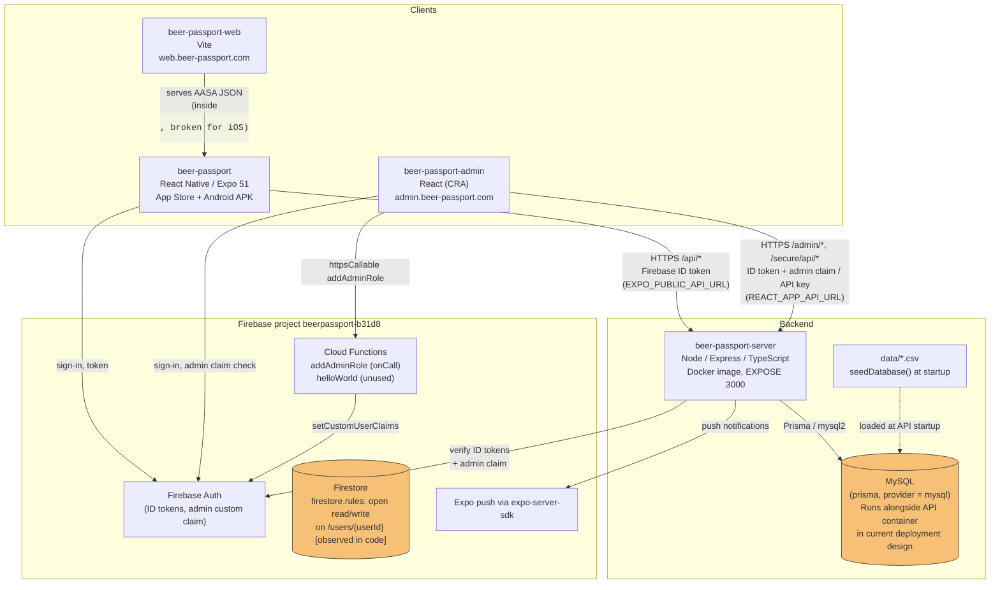

# Architecture

The BeerPassport system as it exists today, verified against the five repositories in October 2026. Facts are stated plainly; anything inferred or unverifiable is marked. The proposed future architecture from the relaunch plan is summarized at the end and kept separate.

## High-level diagram

## Responsibilities by repository

See [REPOSITORIES.md](REPOSITORIES.md) for the full inventory. In brief:

- `beer-passport` owns the mobile UX: navigation, screens, deep-link handling, API calls with the Firebase ID token.
- `beer-passport-server` owns the API, the Prisma data model, server-side auth enforcement, notifications, and catalog seeding.
- `beer-passport-admin` owns catalog administration, API key issuance, and usage analytics.
- `beer-passport-web` owns the public landing page and serves the Apple App Site Association file.
- `beerpassport-cloud-functions` owns admin custom-claim assignment.

## Communication paths (verified)

- Mobile to API: HTTPS to `${EXPO_PUBLIC_API_URL}/api/...`, every request carrying the Firebase ID token. The server's `decodeUserToken` middleware verifies it.
- Admin to API: HTTPS to `${REACT_APP_API_URL}` with `/admin/*` routes (ID token plus `admin` custom claim, enforced by `decodeAdminToken`) and `/secure/api/*` bulk routes (API key, enforced by `decodeAPIKey`).
- Admin to Cloud Functions: `httpsCallable` invocation of `addAdminRole`.
- API to Firebase Auth: token verification and `admin` claim checks via `firebase-admin`.
- API to mobile users: push notifications through `expo-server-sdk`.
- API to database: Prisma with the `mysql2` driver; `DATABASE_URL` from the environment.
- Web to mobile: Universal Links via `applinks:web.beer-passport.com`, path `/beers/*` (currently broken because the association file is served as HTML inside a `<pre>` element).

## Data ownership and flows (verified where stated)

- The relational database (MySQL, Prisma-managed) is the system of record for users, beverages, breweries, friendships, user logs, collections, badges, and notifications.
- Catalog seed data lives as CSV files in `beer-passport-server/data/` and is loaded by `seedDatabase()` during API startup (observed in code; flagged as an architectural problem in the audit).
- Firestore is configured in the cloud-functions repo, and its rules allow open read/write on `/users/{userId}` (observed in the repo's `firestore.rules`; whether these exact rules are deployed is unverified). What the app stores in Firestore, if anything, was not established from the code reviewed.
- The mobile app uses Firebase Auth directly for sign-in; the server keeps its own user records mapped to Firebase UIDs (mapping consistency not fully verified).

## Authentication and authorization boundaries (verified)

- Firebase ID tokens are the primary credential; the server verifies them with `firebase-admin`.
- Three middleware gates exist on the API: `decodeUserToken` (`/api`), `decodeAdminToken` (`/admin`, requires the `admin` custom claim), `decodeAPIKey` (`/secure`).
- Auth failure paths return JSON without setting an HTTP error status (Express defaults to 200), except "User not in database" which sets 404. Confirmed in code.
- The admin UI gates sign-in on the client-side `admin` claim check, but the security boundary is the server middleware (accepted decision TD-3).
- Whether every admin route is actually covered by server-side authorization is unverified (audit item, needs endpoint review).

## Deployment and infrastructure (partially verified)

- The API ships as a Docker image (`node:lts-alpine`) whose `CMD` runs `start:prod`: fetch secrets from AWS Secrets Manager (region `us-east-1`, secret `prod/beerpassport/backend` by default), write them to a local `.env`, run a healthcheck, run `prisma migrate deploy`, then start the server. Where this image is hosted and how it is orchestrated was not established from the code.
- The database currently runs alongside the API container in the deployment design (audit finding 1.3, critical); managed-database separation is proposed, not implemented.
- The admin site deploys via `npm run deploy` to S3 bucket `beerpassportadmin` with a CloudFront invalidation.
- The web site's hosting target was not established.
- Backups, restore drills, and spend alerts are not evidenced in the repositories (audit item 6.3).

## Known architectural risks

1. **Database coupled to API compute** (audit 1.3, critical): scaling or replacing API containers risks duplicate databases or data loss.
2. **Secrets handling**: `.env` copied into the Docker build context; the runtime secret loader writes secrets to a local `.env` file (audit 1.1, 1.2, both confirmed).
3. **Auth failure status codes**: failures can look like success to clients (audit 1.6, confirmed).
4. **Deep-link contract is inconsistent three ways**: AASA path `/beers/*`, react-navigation config `Beer: "beers/:id"` (path param), manual `DeepLinkContext` handler expecting `?id=` query param; the linking config also passes `id` (string) to a screen declared as `beer_id: number`. None fully agree.
5. **Firestore rules observed as wide open** in the repo (unverified whether deployed).
6. **No API versioning**: backend changes can break older installed mobile apps (audit 6.2).
7. **Catalog seeding at startup** makes data initialization and application startup interdependent (audit 1.4, confirmed).

## Proposed future architecture (from the relaunch plan, not implemented)

- API instances stateless and disposable; database persistent, managed, and independent of API compute.
- Versioned API routes (`/api/v1`), additive changes, expand-and-contract migrations, contract tests.
- Catalog import as explicit admin jobs with validation, duplicate detection, and import reports.
- Image storage with provenance metadata and an approval workflow.
- No Redis, Kubernetes, microservices, or dedicated background processing unless real workloads justify them.
- Hosting: compare lean managed hosting vs AWS-native on total monthly cost; the database is expected to be the largest fixed expense.
